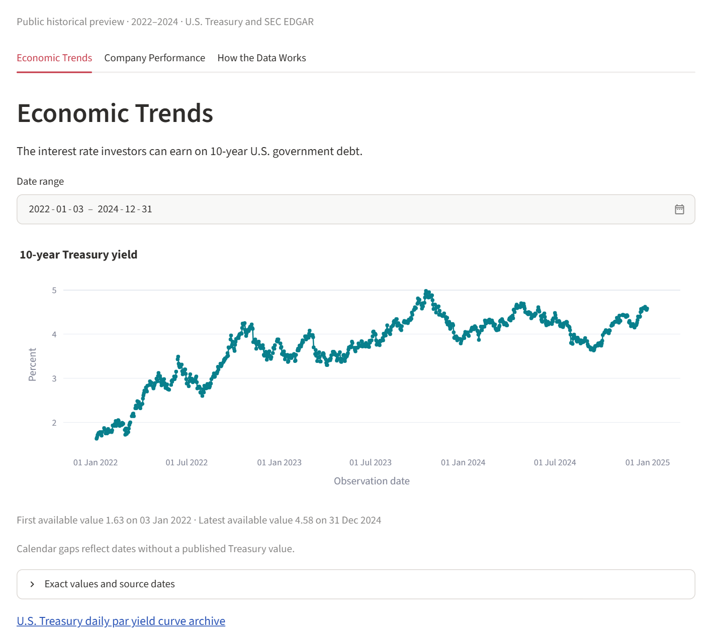
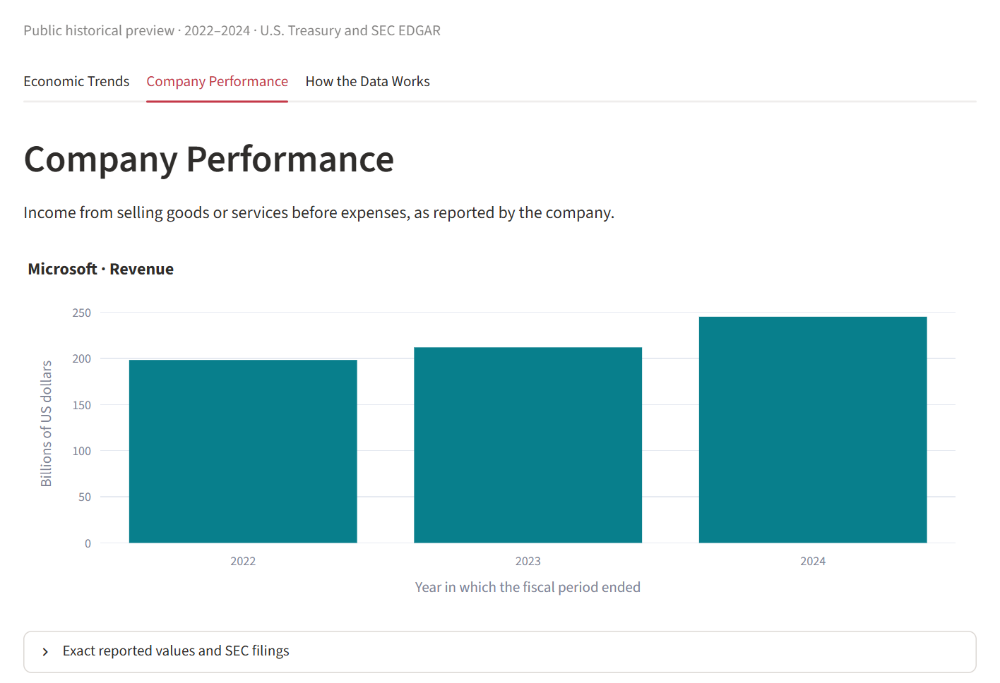
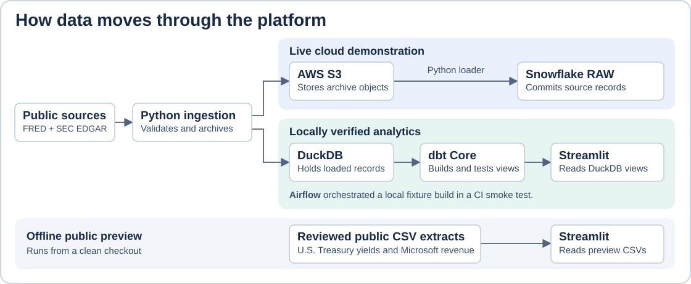

# Financial Data Engineering Platform

The Financial Data Engineering Platform turns public economic releases and company filings into an interactive dashboard. The public preview lets you explore the U.S. 10-year Treasury yield and compare Microsoft's annual revenue from 2022 through 2024. The full local build covers additional measures from FRED and SEC EDGAR, including consumer prices, unemployment, company earnings, and cash flow.

Economic data can be revised, and companies can amend filings or report figures for different periods. The pipeline saves and validates the original responses in batches that can be replayed. dbt Core applies the same rules on each DuckDB rebuild to select comparable figures and preserve links to the underlying records. Streamlit reads the prepared data in the full build and uses two reviewed public extracts for the offline preview.

## Open the historical preview

From the repository root with Python 3.11 or 3.12, create a virtual environment.

```sh
python -m venv .venv
```

Activate it with `.venv\Scripts\Activate.ps1` in PowerShell or `source .venv/bin/activate` in Bash or zsh.

```sh
python -m pip install -r requirements-dashboard.txt
python -m streamlit run dashboard/app.py --server.address 127.0.0.1 --server.headless true --browser.gatherUsageStats false
```

Open the localhost URL printed by Streamlit. After installation the preview runs offline without credentials and includes source dates and filing links. A local analytics build takes precedence when available. [Preview sources and reuse terms](docs/public-preview.md)

### Economic Trends



The date range control filters daily yields from the U.S. Treasury. Gaps mark dates without a published value.

### Company Performance



Compare three complete Microsoft fiscal years and open the SEC filings behind the bars.

## How the platform works



The live demonstration verified storage in S3 and loading into Snowflake RAW. The analytics build and dashboard were verified locally with DuckDB and dbt Core. Airflow ran a fixture build in CI. Snowflake/dbt parity remains untested. [Architecture and verification details](docs/architecture.md)

## Verification

- **Private local history.** The 2019–2025 capture produced 3,934 FRED observation rows and 3,682 selected company facts for 12 issuers. All 31 DuckDB dbt data tests passed.
- **Historical cloud demonstration.** Four batches committed through S3 to Snowflake RAW. Replay and rollback were verified. The Snowflake demonstration objects were removed, and independent AWS checks confirmed removal of all eight Terraform-managed resources. [Verification record](docs/phase7-publication.md#verification-record)
- **Airflow runtime.** The CI smoke test verified workflow discovery, retry recovery, failure blocking, and DuckDB publication after all 43 dbt nodes passed. [GitHub Actions run 44985167711](https://github.com/zidaneb29/financial-data-engineering-platform/actions/runs/44985167711)

[Build and test the pipeline offline](docs/phase5-airflow.md#run-the-local-smoke-test) · [Rebuild the private history](docs/dashboard-history.md)

[MIT code license](LICENSE) · [Separate preview data notices](preview/NOTICE.md)
