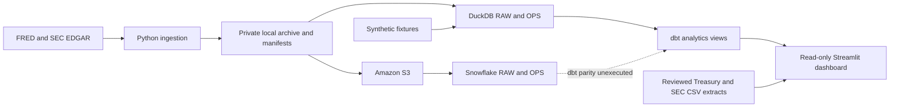

# Architecture

Phase 1 implements Python ingestion, filesystem storage, and offline tests. [Local ingestion](local-ingestion.md) describes the executable interface and on-disk contract. Snowflake is the target SQL engine. Snowflake SQL behavior requires a separately approved Snowflake integration run.

Phase 2A adds validated schema 2 manifests, checked normalized files, durable sequence reservations and SEC snapshot-aware selection. The [cloud loader contract](cloud-loader-contract.md) defines the transfer boundary and compatibility rules.

Phase 2B implements S3 transfer, client-mediated Snowflake RAW loading, exact numeric quarantine and cloud command wiring. Verification is offline. The [cloud integration guide](cloud-integration.md) documents execution, setup, costs and teardown.

Phase 3B verified the bounded Snowflake RAW load, replay and teardown. Phase 4 adds dbt Core views over the committed RAW and OPS contract, with credential-free DuckDB verification and a separately approved Snowflake parity run. See [Phase 4 dbt transformations](phase4-dbt.md).

Phase 5 adds a manual Airflow fixture DAG and a host smoke command that execute the same local stages. The container runs without external networking. See [Phase 5 orchestration](phase5-airflow.md) for the proposed live task graph and the verification checkpoint.

Phase 6 serves a local Streamlit dashboard over the read-only DuckDB publication. See [Phase 6 dashboard](phase6-dashboard.md) for displayed grains, provenance and startup.

## Execution paths

| Environment | Flow | Verification |
| --- | --- | --- |
| Offline development | Test fixtures → ingestion functions → temporary filesystem | Parsing, pagination, retries, checkpoints, replay, and failure recovery |
| Local transformations | Synthetic RAW and OPS batches → DuckDB → dbt | SQL models, lineage, exact values and point-in-time regression tests |
| Local orchestration | Deterministic fixture → validation → DuckDB dbt build | Retry-safe fixture creation, failure propagation and atomic analytics publication |
| Local analytics | Published DuckDB dbt views and warehouse ledger → Streamlit and Plotly | Source coverage, reporting contexts, missing values and lineage |
| Local live development | Source API → Python CLI → filesystem | Opt-in source connectivity and representative payload handling |
| Historical cloud demonstration | Python CLI → local archive → S3 → Snowflake RAW and OPS | Scoped transfer, transactional load, replay, rollback and teardown |
| Prepared adapter comparison | Preserved local RAW and OPS → dedicated Snowflake database → dbt | [Exact row comparison](phase7-snowflake-parity.md) awaits approved execution |

Implement the CLI and storage contract before Airflow. Use the same functions for scheduled and manual runs. Use Linux containers under Docker Compose on Windows when Airflow is introduced. Keep the Compose stack as a local demonstration environment. Pin application, adapter, and container dependencies as each component is introduced. [Airflow Docker guidance](https://airflow.apache.org/docs/apache-airflow/stable/howto/docker-compose/index.html)

## Publication and recovery

1. Fetch a bounded request using explicit timeouts, safe request metadata, and limited retries with jitter. Honor `Retry-After` where available. Rate-limit per provider across concurrent workers or serialize calls.
2. Hash the decoded HTTP response body bytes and store them as received. Use `raw/<source>/<entity>/<endpoint>/<sha256>.json` with a configurable storage root. Reuse identical bodies within an entity and endpoint, retaining the retrieval events separately.
3. Validate each response and pagination completeness. Publish a versioned manifest containing run ID, source entity, request window or snapshot date, UTC timestamps, ordered object keys and hashes, schema version, and counts. Never include credential-bearing URLs. A published manifest signals a complete set of inputs. Partial downloads without a manifest are invisible to loaders.
4. Phase 1 uses one writer per data root and publishes one manifest per successful entity attempt. It derives FRED coverage from contiguous committed windows and reconciles interrupted journals on restart. CLI reruns make a fresh fetch and deduplicate normalized records. A future orchestrated loader should use the committed manifest identity as its stable batch identifier across retries.
5. In Snowflake, load manifest-selected files into work tables, validate expected counts and hashes at the appropriate boundary, and merge into RAW with explicit natural keys. Commit RAW merges and successful batch tracking together. Snowflake's file load history is time-limited, so it cannot serve as the durable replay ledger. [Snowflake load history](https://docs.snowflake.com/en/user-guide/data-load-considerations-load)

Phase 1 uses same-directory temporary files and atomic replacement and publishes normalized JSON Lines changes. Phase 2 should design S3 publication around conditional creation of immutable objects and manifests. Evaluate Parquet when volume or repeated scans justify a second format.

## Warehouse and transformation

Use one Snowflake database with RAW, STAGING, ANALYTICS, and OPS schemas. Maintain raw JSON and technical lineage in RAW, normalize source semantics in dbt staging, and publish dimensional models in ANALYTICS. Use explicit deploy-time schema configuration and isolate development targets. See [data contracts](data-contracts.md) for grains and keys.

Start with views and rebuild small marts while their semantics stabilize. Introduce incremental merges when measured cost or runtime warrants them. Detect work from committed batches or affected keys, including late revisions and amended filings. Derive the latest view independently of load order. Use dbt checks for key uniqueness, foreign-key coverage, accepted units and period classes, and materialized row reconciliation.

The prepared Terraform template owns a private encrypted S3 bucket and a scoped IAM policy. Separate administrator SQL defines RAW and OPS tables in an existing Snowflake database. The Phase 2B loader verifies transferred bytes from the local client and submits bounded parameterized DML. Direct S3 stages and a Snowflake storage integration can be introduced after volume measurements justify bulk COPY. Separate upload, load, transform and reporting privileges.

## Scheduling and analytics

Start with one daily DAG and bounded backfill parameters. Run FRED and SEC independently, load completed manifests, then run `dbt build`. Publish marts after required tests pass. Serialize writers to shared targets. Configure task retries for transient failures and report final failure in Airflow and OPS where available. Track per-source last success, counts received/loaded/rejected, duplicate counts, and source freshness separately from pipeline freshness. A healthy retrieval may legitimately have no new observations or filings.

The Streamlit dashboard reads the published DuckDB database over a read-only connection. It shows source values, filing choices and committed batch evidence. The [hosted Airflow smoke](phase5-airflow.md#phase-7-hosted-runtime-check) and [Snowflake parity check](phase7-snowflake-parity.md) are separate from the dashboard runtime.

The [historical dashboard build](dashboard-history.md) validates the local archive, projects the warehouse rows with the shared loader contract and publishes a fresh local database after dbt passes. Streamlit uses that publication to explore economic and annual company trends.

## Cost and teardown

Stage the run on local fixtures first. Before provisioning, document current region-specific S3 storage, request and transfer estimates, Snowflake credit and storage estimates, and actual account eligibility. Obtain explicit approval. Use a single X-Small warehouse with short auto-suspend, group work to limit repeated starts, and configure an account-approved resource monitor where available. Warehouse starts have a 60-second minimum. Plan against the $0–$10 target and $15 approval threshold. Skip persistent compute, managed orchestration, and serverless ingestion. [AWS S3 pricing](https://aws.amazon.com/s3/pricing/) · [AWS account benefits](https://aws.amazon.com/free/) · [Snowflake trial](https://docs.snowflake.com/en/user-guide/admin-trial-account) · [Warehouse billing](https://docs.snowflake.com/en/user-guide/warehouses-considerations)

For the demonstration teardown, stop scheduling and refreshes, capture sanitized evidence, and suspend the warehouse. Remove the dedicated Snowflake warehouse, stages, database, integration, and project roles as appropriate. Account for retained Snowflake data under the configured retention policy. Empty the dedicated S3 bucket, including versions, delete markers, and incomplete multipart uploads if present. Destroy the Terraform-managed AWS resources from the matching state. Verify bucket and IAM removal, absence of project Snowflake resources, and stopped schedules. Check usage again after billing data refreshes. The cloud demonstration will use a resource-specific runbook before deployment.

